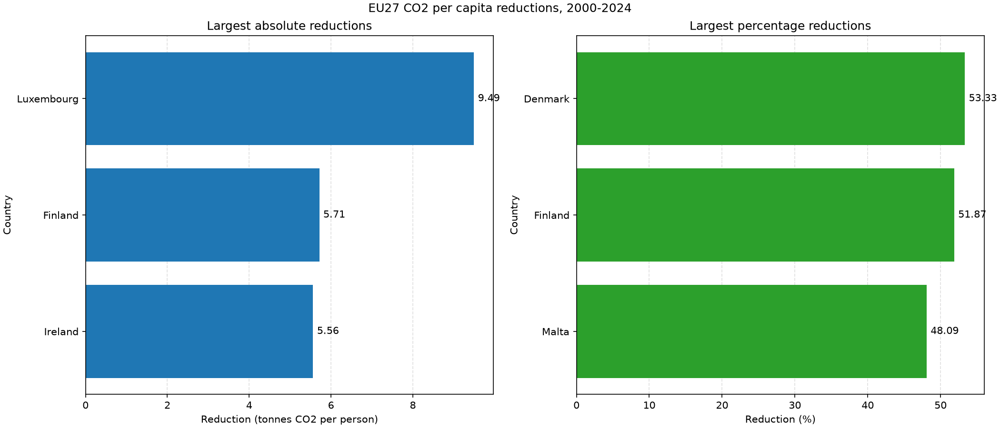

# co2-pipeline

Which EU country has reduced its CO₂ emissions per person the most since 2000?

Lab 4 of the course Data Integration (TH Köln). Pair: Chaymae and Ülkü.

## Answer

We compare the 27 EU member states from 2000 to 2024. The answer depends on how you read "the most".

**Biggest cut in tonnes per person**

| | Country | 2000 | 2024 | Cut |
|---|---|---|---|---|
| 1 | Luxembourg | 19.953 t | 10.460 t | −9.493 t |
| 2 | Finland | 11.015 t | 5.301 t | −5.714 t |
| 3 | Ireland | 11.900 t | 6.339 t | −5.561 t |

**Biggest cut in percent**

| | Country | 2000 | 2024 | Cut |
|---|---|---|---|---|
| 1 | Denmark | 10.170 t | 4.746 t | −53.33 % |
| 2 | Finland | 11.015 t | 5.301 t | −51.87 % |
| 3 | Malta | 6.172 t | 3.204 t | −48.09 % |



**Which answer we would present:**

We would present Denmark because it achieved the largest percentage reduction (53.33%). Percentage reductions make it easier to compare countries with different emission levels in 2000.

Luxembourg achieved the largest absolute reduction per person (9.493 tonnes). However, its population increased by approximately 54% between 2000 and 2024, while total CO₂ emissions decreased by approximately 19%. Both developments contributed to the reduction in emissions per person.

Finland appears in the top three in both rankings. Therefore, both measurements are useful, but we prefer the percentage reduction for comparing countries.

## How to run it

### macOS / Linux

```bash
python3 -m venv .venv
source .venv/bin/activate
python -m pip install -r requirements.txt

python src/download.py
python src/clean_co2.py
python -m pytest
python src/analyse.py
```

### Windows (PowerShell)

```powershell
python -m venv .venv
.\.venv\Scripts\Activate.ps1
python -m pip install -r requirements.txt

python src/download.py
python src/clean_co2.py
python -m pytest
python src/analyse.py
```

If PowerShell blocks activation, use Command Prompt or Anaconda Prompt:

```cmd
.venv\Scripts\activate.bat
```

The pipeline downloads the pinned OWID dataset, creates the cleaned dataset, runs the tests and saves the chart in `figures/`.

On macOS with Python from python.org, it may be necessary to run the official `Install Certificates.command` to resolve SSL certificate errors.

## Data and sources

- **Dataset:** CO₂ and Greenhouse Gas Emissions, by Our World in Data. Source: https://github.com/owid/co2-data, pinned to commit `382ee6c662b0ece26e111f263b44c029afad7787` (2 June 2026). Licence: CC BY 4.0.
- **Dataset authors:** Pablo Rosado, Hannah Ritchie, Max Roser, Edouard Mathieu and Bobbie Macdonald.
- **Original sources of the columns we use** (from the column `source` of the codebook):
  - `co2`: Global Carbon Budget (2025), https://globalcarbonbudget.org/
  - `population`: Population based on various sources (2024), https://ourworldindata.org/population-sources
  - `co2_per_capita`: Global Carbon Budget (2025) and Population based on various sources (2024)

The OWID dataset is available under CC BY 4.0. Data originating from third parties may have separate licence conditions. We credit OWID and the original data sources used in this analysis.
How we worked: see `workflow.md`. How we used AI: see `AI_USAGE.md`.

